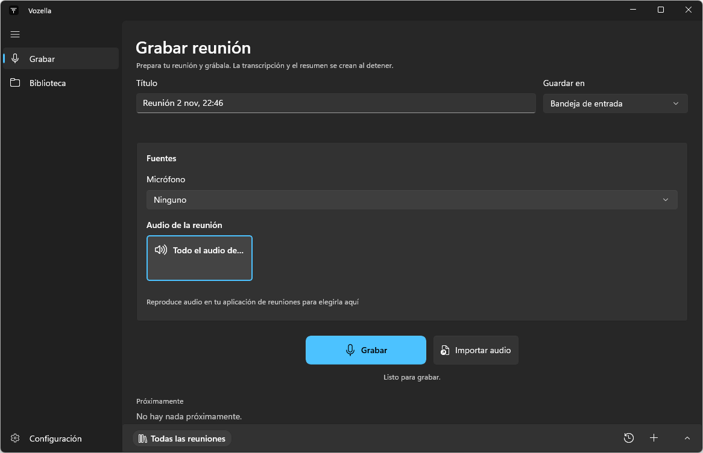

<picture>
  <source media="(prefers-color-scheme: dark)" srcset="docs/brand/vozella-tile-light.svg">
  
</picture>

# Vozella

Every meeting, written down.

**Status:** pre-release, Windows only, no installer yet. Build from source.



## What it does

- **Records without a bot.** Captures your microphone plus all system audio or a single app, and nothing joins the call. You can also import audio.
- **Transcribes.** Shows a live preview while recording, then writes the final transcript from the recording after you stop. Speaker labels are optional, for up to four voices.
- **Writes notes.** Summaries, action items and templates.
- **Helps during the call.** A live copilot window, detected questions and "What did I miss?".
- **Reminds you.** Windows calendar reminders about one minute before meetings with two or more people, and a popup when a Zoom, Teams or Meet call is detected.
- **Keeps a library.** Folders, search, and chat scoped to a meeting, a folder or all meetings.

| Option | Choices |
| --- | --- |
| Summary and chat engine | Local (GGUF on this PC, no account), Claude Code or Codex (your own signed-in CLI), Grok (xAI) |
| Transcription language | Auto, English, Spanish, Portuguese, French, German, Italian, Dutch, Japanese, Chinese |
| UI and summary language | English, Spanish |

## Where your data goes

| Data | Where it goes |
| --- | --- |
| Transcription | Runs on this PC. The speech model and a small runtime download once during setup. |
| Summaries and chat | Go to the engine you choose. Local stays on this PC; Claude Code, Codex and Grok send the text to their services. With Claude Code or Codex, live answers can also search the web. |
| TypeSafe (optional) | Sends the transcript to TypeSafe. Off until you save a key. |
| Meetings and recordings | Markdown files with their recordings in `Documents\MeetingLive`. This folder follows OneDrive redirection, so a redirected Documents folder puts them in OneDrive too. |

The folder keeps its old name on purpose. See [Naming](#naming).

## Build and run

Prerequisites:

- Windows on x64 (the transcription runtime is x86_64 only)
- .NET 10 SDK (`global.json` pins `10.0.400` with `rollForward: latestFeature`)
- WinApp CLI v0.6+ (`winget install Microsoft.winappcli`)
- Windows Developer Mode

Build, run and test each project on its own:

```powershell
# Build the app
dotnet build MeetingLive.App/MeetingLive.App.csproj -p:Platform=x64

# Run the app
winapp run MeetingLive.App/MeetingLive.App.csproj -c Debug --arch x64 --debug-output

# Run the unit tests
dotnet test MeetingLive.Core.Tests/MeetingLive.Core.Tests.csproj
```

Do not build or test `MeetingLive.sln`. Its `Any CPU` mapping conflicts with the app's `x86;x64;ARM64` platforms and fails with `MSB4126`.

## Project layout

| Folder | Contents |
| --- | --- |
| `MeetingLive.App/` | WinUI 3 desktop app |
| `MeetingLive.Core/` | UI-independent logic: audio, transcription, summaries, storage |
| `MeetingLive.Core.Tests/` | xUnit tests |
| `website/` | Landing page |
| `docs/brand/` | Logo files |
| `docs/screenshots/` | README screenshots |
| `scripts/` | Icon generation |
| `odd/tasks/` | Feature task notes |
| `.agents/`, `.claude/` | Coding agent skills and settings |

Agent and contributor guidance is in [AGENTS.md](AGENTS.md).

## Naming

The product is Vozella. Internal names (namespaces, projects, package identity, data folders) remain `MeetingLive` deliberately, because renaming them can orphan user data or Windows consent.

## License

No license has been chosen yet, so all rights are reserved for now.
